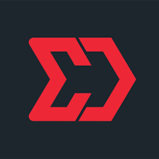
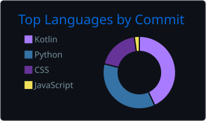

<!-- Header -->

  

  

  
  
  
  

---

## 🧑‍💻 About me

I'm **Adrià**, a software developer based in **Barcelona** 📍, currently working at
**[EDYMA Digital Company](http://edyma.net)**, where I build and maintain business solutions —
mostly around **Odoo**, **Python** and the infrastructure that keeps it all running.

- 💼 &nbsp;Software Developer at **EDYMA Digital Company**
- 🧩 &nbsp;Focused on ERP development, automation and backend
- 🐳 &nbsp;Comfortable with containers, Linux servers and virtualization
- 🌍 &nbsp;Speaks **Catalan** and **Spanish**
- ⚡ &nbsp;Fun fact: I like turning repetitive tasks into scripts

 

## 🛠️ Tech stack

<table>
  <tr>
    <td><b>Languages</b></td>
    <td>
      
      
      
      
    </td>
  </tr>
  <tr>
    <td><b>Frameworks &amp; ERP</b></td>
    <td>
      
    </td>
  </tr>
  <tr>
    <td><b>DevOps &amp; Infra</b></td>
    <td>
      
      
      
    </td>
  </tr>
  <tr>
    <td><b>Tools</b></td>
    <td>
      
      
    </td>
  </tr>
</table>

## 🚀 Featured projects

| Project | Description | Stack |
|---|---|---|
| 🧬 **[GameOfLifeCW](https://github.com/Ninjakito/GameOfLifeCW)** | John Horton Conway's *Game of Life*, implemented in Python. |  |

## 📊 GitHub stats

  

  

<!-- Footer -->

  

